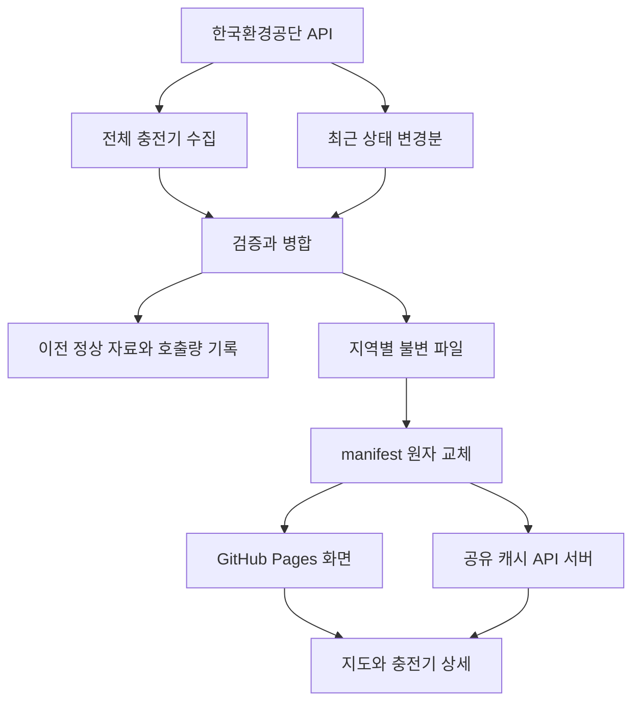

# 충전한눈 운영과 배포

## 운영 구조

기본 배포는 정적 파일입니다. `public`에서 사이트를 빌드하고 `dist` 전체를 Pages 아티팩트로 배포합니다. Python 서버를 따로 운영할 때는 동일한 데이터 계약을 `/api`로 제공합니다. GitHub Pages에서 Python 코드를 실행하지 않습니다.

게시 후 워크플로가 `npm run verify:deployment`를 실행합니다. 실제 공개 루트, 앱 JavaScript·CSS, `build-info.json`, `data/manifest.json`이 HTTP 200으로 열리는지 검사하고 게시된 소스 커밋이 해당 실행의 커밋과 일치해야 성공합니다. CDN 전파 지연은 제한된 횟수만 재확인합니다. 앱 게시 성공과 실제 데이터 미설정 상태는 별도로 출력하며, 미설정 기본 데이터에 예시 시설이 섞이면 실패합니다. Actions 상태 표시만으로 게시 완료를 판단하지 않습니다.

## 배포 경로

| 항목 | 값 |
| --- | --- |
| 소스 저장소 | https://github.com/softm/evchargingstation |
| 운영 URL | https://softm.github.io/evchargingstation/ |
| 체험 URL | https://softm.github.io/evchargingstation/?demo=1 |
| 소스 브랜치 | main |
| Pages Source | GitHub Actions |
| 빌드 디렉터리 | dist |
| 유일한 배포 워크플로 | .github/workflows/collect-and-deploy.yml |
| 동시 실행 제한 | evchargingstation-pages, 진행 중 수집 취소 안 함 |

현재 소스는 별도 결제, 회원 등록, GPS 자동 요청 없이 시작합니다. 사용자의 현재 위치는 현재 위치 버튼을 눌렀을 때만 브라우저가 요청합니다. 즐겨찾기는 이용자의 브라우저에 저장합니다.

## 데이터 상태

| 상태 | 의미 | 화면 처리 |
| --- | --- | --- |
| unconfigured | 아직 실제 수집 결과 없음 | 실제 시설 0건, 데이터 준비 안내 |
| snapshot | 수집된 정적 자료 | 실제 확인 시각과 지연 표시 |
| live | 수집 서버 캐시 연결 | 서버 연결 자체와 충전기 정보 신선도를 별도 평가 |
| demo | 명시적으로 선택한 화면 체험 | 예시 시설·예시 상태 안내, 운영 데이터와 분리 |

예시 데이터는 자동으로 운영 데이터에 섞지 않습니다. API 실패 시 예시를 대신 표시하지 않습니다. 서버가 살아 있어도 마지막 정상 수집이 오래되면 현재 충전대기로 집계하지 않습니다.

## 최신성 기준

| 값 | 의미 |
| --- | --- |
| charger.statusChangedAt | 제공기관의 마지막 상태 변경 시각 |
| charger.observedAt | 해당 충전기 데이터를 실제 받은 시각 |
| region.statusCoverageAt | 모든 변경분 페이지를 빠짐없이 처리한 연속 수집 범위 |
| inventoryUpdatedAt | 전체 기본정보 수집 완료 시각 |

각 충전기의 최근 확인 시각은 `observedAt`과 유효한 `statusCoverageAt` 중 최신값으로 판단합니다. 잘못된 시각·미래 시각은 임의로 최신으로 인정하지 않습니다. 상태 변경이 없더라도 연속 수집이 정상이라면 충전기의 마지막 상태를 유지할 수 있습니다.

API에는 과거 전체 변경 이력을 되짚는 cursor가 없습니다. 10분 조회창을 초과한 공백, 모순되는 페이지, 부분 수집, 인증·한도 오류는 이전 정상 자료를 보존하고 재수집합니다. 제공기관도 조회 도중 상태가 변할 수 있어 단일 시각의 전국 상태를 보장하지 않습니다. 화면은 도착 시 충전 가능 여부를 보장하는 예약 기능이 아닙니다.

## 예약 수집 운영

`ENABLE_SCHEDULED_COLLECTION=true`인 경우 5분 주기로 GitHub 예약 실행을 요청합니다. 예약 실행은 지연·누락될 수 있어 운영용 실시간 SLA로 사용하지 않습니다. 5분 간격은 하루 최소 288회이며 페이지 수와 재시도가 추가됩니다. 1,000회 개발 허용량으로 전국 모든 변경을 계속 처리할 수 있는지는 실제 데이터량에 따라 달라집니다.

호출량은 비공개 상태 디렉터리에 기록하고 GitHub Actions cache로 이어받습니다. 캐시가 소실되면 로컬 누적 기록도 사라질 수 있으므로 제공기관의 실제 한도 오류를 우선하며, 엄격한 계정 전체 쿼터 집계에는 영속 저장소가 있는 전용 서버가 필요합니다. 같은 인증키를 다른 프로그램에서 사용한 호출은 이 앱이 관찰하지 못합니다.

주기 수집이 실패해도 새 UI 배포는 계속할 수 있지만 이전 snapshot의 확인 시각은 유지합니다. Actions 요약과 warning에 수집 실패를 남깁니다. 무결성을 확인한 지역 파일을 먼저 쓰고 manifest를 마지막에 교체해 서로 다른 실행의 파일이 섞이지 않게 합니다.

명시적으로 `workflow_dispatch`에서 `collection_mode: full`을 선택한 실행은 수집 설정 활성과 수집 단계 성공을 모두 요구합니다. 충족하지 않으면 요청 예산·이전 정상 데이터 캐시를 보존한 뒤 오류로 종료하고 신규 빌드·배포를 중단합니다. `push`, 수동 `auto`, 예약 실행의 기존 snapshot 보존·UI 배포 정책은 유지합니다. 2026-10-20 현재 실제 수집은 인증 오류로 미완료이며 예약 수집은 비활성입니다. [최신 검증 기록](VALIDATION.md)을 참고하세요.

## 최초 실데이터 확인 절차

| 순서 | 확인 내용 | 통과 기준 |
| --- | --- | --- |
| 1 | 공공데이터 활용승인과 Secret | 인증키를 브라우저에 공개하지 않고 full 수집 성공 |
| 2 | 전체 목록 | 모든 페이지 완료, 총 충전기 수·중복·삭제 처리 검사 |
| 3 | 지도 | 실제 지역 2곳 이상에서 원본 위치와 마커 대조 |
| 4 | 상태 | 실제 충전기 ID·상태·변경 시각을 원본과 대조 |
| 5 | 빈 변경분 | 빈 응답 후 기존 목록 유지 |
| 6 | 중단·오류 | 상태를 거짓으로 최신 갱신하지 않고 정상 스냅샷 유지 |
| 7 | 도메인 | 네이버 지도 인증과 길찾기 링크를 실제 배포 URL에서 확인 |
| 8 | 모바일 | 상세 닫기, 화면 이동·배율, 목록과 마커 선택 유지 |

## 진단 링크

- [워크플로 실행 기록](https://github.com/softm/evchargingstation/actions/workflows/collect-and-deploy.yml)
- [Actions Secret 설정](https://github.com/softm/evchargingstation/settings/secrets/actions)
- [Actions Variable 설정](https://github.com/softm/evchargingstation/settings/variables/actions)
- [Pages 설정](https://github.com/softm/evchargingstation/settings/pages)
- [공공데이터 API 원문](https://www.data.go.kr/data/15076352/openapi.do)
- [GitHub 예약 이벤트의 공식 제한](https://docs.github.com/en/actions/reference/workflows-and-actions/events-that-trigger-workflows#schedule)

## 출시 범위

이번 구현은 지도 웹앱과 API 수집 서버입니다. Android·iOS 스토어용 바이너리, 앱 서명, 스토어 등록, 결제·예약 API와 운영 서버 계약은 포함하지 않습니다. 웹앱 주소와 별개로 운영 도메인·네이티브 패키지·스토어 메타데이터는 실제 출시 설정 때 확정합니다.
